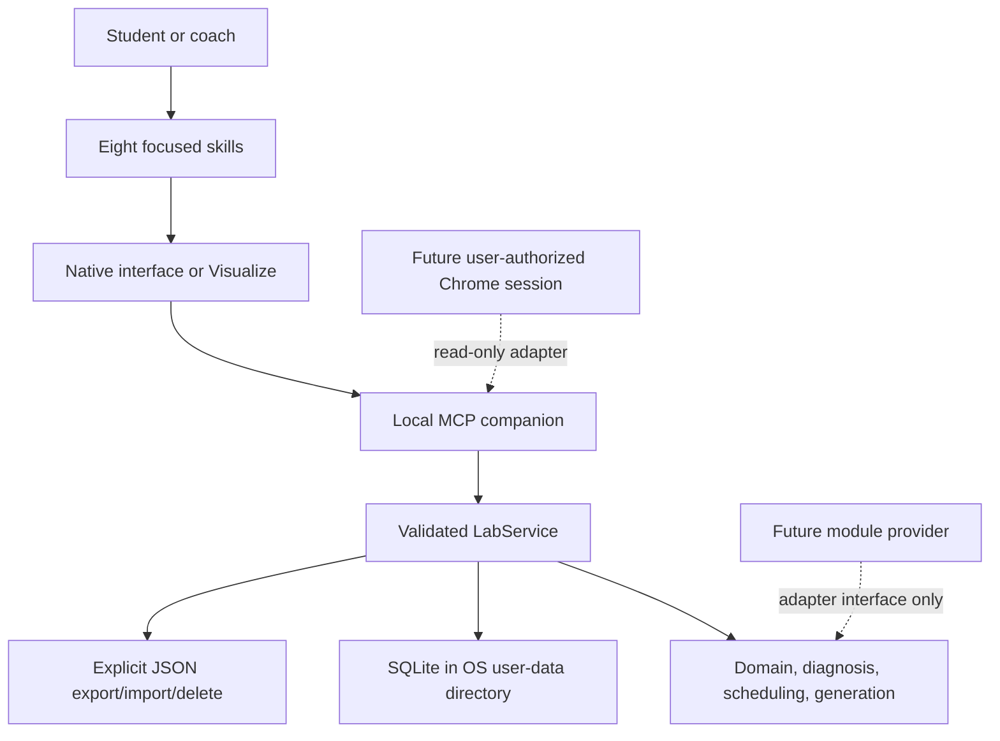

# OpenSAT architecture

## Selected split

The package is one installable plugin with eight focused skills and one local MCP companion:

## Components

- `.codex-plugin/plugin.json`: installable plugin manifest and focused-skill discovery.
- `skills/`: onboarding, practice scan, mistake autopsy, daily sprint, strategy lab, progress review, public-question pattern research, and a separate plugin self-improvement workflow. Learner-facing skills use the same learner model; research records public source links and abstract mechanisms, while self-improvement works only on plugin source and synthetic/public evaluation artifacts.
- `.mcp.json`: local stdio server wiring. It launches `scripts/mcp_server.py` from the plugin root.
- `src/opensat/practice_scan/`: the user-authorized, read-only Chrome observation boundary, prompt-injection gates, metadata allowlist, transient snapshot disposal, and resumable cursors.
- `src/opensat/domain/`: vocabulary, band priors, content labels, and small models.
- `src/opensat/learner_model/`: the application service and persistence-facing operations.
- `src/opensat/storage/`: SQLite schema, migrations, foreign keys, and backup-before-migration behavior.
- `src/opensat/diagnosis/`: adaptive autopsy prompts and conservative hypothesis/signature status transitions.
- `src/opensat/scheduling/`: transparent review heuristic and exact 20-minute plans.
- `src/opensat/generation/`: item specification and multi-stage validation gate.
- `src/opensat/providers/`: future provider contracts, including the non-live Gemini module stub.
- `scripts/`: CLI and MCP entrypoints.
- `scripts/self_improvement.py`: freeze and receipt gate for a bounded plugin-development experiment; it is not an MCP learner-data tool.
- `docs/visual-practice-surface.md` and `schemas/daily-sprint-submission.schema.json`: the no-GUI Visualize interaction contract and content-free answer payload.
- `docs/`, `schemas/`, `migrations/`, `tests/`, `examples/`: reviewable contracts and synthetic validation material.

## Persistence boundary

`LabService` is the only supported write boundary. It validates enum values, ownership, idempotency keys, safe metadata, diagnostic transitions, and explicit delete confirmation before touching SQLite. MCP and CLI calls do not write separate state.

The default runtime root is platform-specific:

- macOS: `~/Library/Application Support/OpenSAT/`
- Windows: `%LOCALAPPDATA%\\OpenSAT\\`
- Linux: `$XDG_DATA_HOME/opensat/` or `~/.local/share/opensat/`
- fallback: `~/.opensat/`

The `OPENSAT_DATA_DIR` override makes tests deterministic; the former `SAT_PRECISION_LAB_DATA_DIR` name remains accepted for local compatibility. The repository contains no runtime database, exports, browser cache, or credentials.

## Extension seams

- Math can add domain skills and item specifications without changing learner identity or event contracts.
- A Chrome adapter can implement `begin_practice_import` and resumable observation steps without receiving credentials or persisting page content.
- A provider can implement candidate generation behind the item-specification gates.
- Gemini is represented as a module-level provider because a complete module cannot serve the targeted-item engine.
- Daily Sprint can render an interactive Visualize surface when native OpenSAT UI is unavailable. Visualize sends a structured follow-up to the assistant; only the validated MCP service persists learner evidence. A future native interface replaces this surface instead of using both.

## Current limitations

The MCP server implements the local tool contract over stdio but does not yet connect to Chrome. The exact provider API and cross-surface plugin availability are environment-dependent and must be rechecked when the plugin is installed in a target client.
